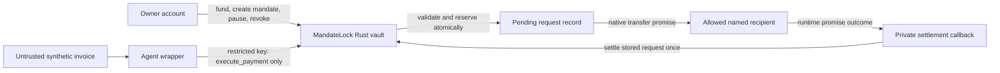

> Preserved historical report; local path prefixes redacted for migration. Current status: PHASE2B.md. Some local diagnostic log links are excluded from the upload.

# MandateLock — Phase 0: Architecture & Security Validation

Research date: October 30, 2026 (America/New_York). Target submission: November 14, 2026, supplied by the owner; event rules, eligibility, track, and cutoff time have not been independently verified. Former working name: AgentGate.

Subsequent status: Phase 0 was accepted and Phase 1A setup was authorized. See [ENVIRONMENT.md](ENVIRONMENT.md) for the current native Windows toolchain and verified Wasm build. Its tagged-release Rust 1.93 selection and Windows-build/Linux-CI split supersede the provisional prerequisites below; this report remains the historical Phase 0 record.

Phase 1B implementation and local verification are now recorded in [PHASE1B.md](PHASE1B.md). The design-only status below describes Phase 0, not the current implementation.

**Status: design only. Nothing described as proposed below has been implemented or tested.** Inspection and public-source research were read-only. The only project changes are this report and the minimal README. No dependencies were installed, Git repository initialized, accounts created, transactions constructed/signed/submitted, funds spent, contracts deployed, or external records changed. No other project directories or personal-project source were accessed.

## 1. Executive summary

**Recommendation: conditional GO for a small security prototype; NO-GO for production custody or claims of unique, guaranteed security.** Build a single-owner, single-active-mandate native-NEAR vault with contract-side authorization and atomic budget reservation. The main proof is that competing requests cannot collectively commit more than the mandate, including requests whose outgoing transfers or callbacks remain unresolved.

NEAR function-call keys constrain the destination contract, callable methods, attached deposit, and gas allowance. They do not inspect payment arguments or supply a token-spending budget. MandateLock must enforce every monetary rule in its own state machine. See [NEAR access keys](https://docs.near.org/protocol/accounts-contracts/access-keys).

There is a credible, narrow competitor gap: OutLayer's custody documentation acknowledges best-effort cumulative counters under concurrency. MandateLock would put the cumulative check and reservation in one onchain state transition, with public outcomes. This is a design comparison, not an independently reproduced vulnerability or proof of market novelty. OutLayer already provides many other policy controls. See [OutLayer agent custody](https://app.outlayer.ai/docs/agent-custody).

The local environment is **not ready for Phase 1**. Rust and NEAR tools are absent from PATH; a working Linux sandbox route has not been established. Resolve prerequisites only after approval. A scoped demonstration is plausible within the remaining roughly two weeks, provided toolchain setup and asynchronous integration tests succeed early.

## 2. Verified NEAR capabilities and evidence

These references were read during this session. Protocol facts below are separate from the proposed application rules in sections 3–9. No source constitutes an audit of MandateLock.

| Reference | Verified capability | What MandateLock must add |
| --- | --- | --- |
| [Access keys](https://docs.near.org/protocol/accounts-contracts/access-keys) | Function-call keys bind a receiver and optionally method names; they prohibit attached NEAR and have an optional gas allowance. Full-access keys can transfer, redeploy, delete, and change keys. | Budget, argument checks, agent identity, expiry, replay protection; explicit nonempty method list. Gas allowance is separate from principal. |
| [Account environment](https://docs.near.org/smart-contracts/anatomy/environment) | Exposes predecessor, original signer and signing key, block timestamp, attached deposit, balance, storage usage and byte cost. | Authorize the immediate caller; reject proxy-origin calls; compare integer amounts and timestamps. |
| [Runtime](https://docs.near.org/protocol/network/runtime) | Applies receipt operations and updates account state on its shard; contracts access their own storage. | Keep the entire budget check and reservation in one vault invocation with no asynchronous dependency between them. |
| [Transaction lifecycle](https://docs.near.org/protocol/transactions/transaction-execution) | Actions in a failed receipt revert together; separate receipts have separate outcomes. Execution completion and consensus finality differ. Access-key nonces prevent reuse of accepted protocol transactions. | Application request IDs prevent resubmitting the same logical payment in a freshly signed transaction. Inspect every relevant receipt, not just the root transaction status. |
| [Cross-contract calls](https://docs.near.org/smart-contracts/anatomy/crosscontract) | Promises and callbacks execute separately; other invocations can intervene; downstream failure does not undo prior caller state. | Reserve before sending; settle using the genuine promise result; tolerate arbitrary intervening requests. |
| [Private callbacks](https://docs.near.org/smart-contracts/security/cross-contract-calls/callbacks) | Rust `#[private]` restricts a callback to the contract's own predecessor identity. | Validate result count and stored pending record; do not accept a user-supplied success flag or amount. |
| [Refund handling](https://docs.near.org/smart-contracts/security/cross-contract-calls/refunds) | Failed attached-value calls return value to the sending contract, rather than automatically to the originating user. | Never refund the agent: outgoing principal belongs to the vault. Distinguish budget release from actual refund arrival. |
| [Transfers and actions](https://docs.near.org/smart-contracts/anatomy/actions) | Native transfer is a protocol action; a nonexistent named receiver is a usable failure case. Implicit addresses have different creation behavior. | Use only named recipients for the first prototype; do not simulate native failure with a recipient contract panic. A plain transfer invokes no recipient method. |
| [Storage](https://docs.near.org/protocol/storage/storage-staking) | Onchain storage needs account funding and growth can cause storage exhaustion. | Pre-fund bounded records and protect a conservative storage/operating floor. Do not equate raw account balance with available payment principal. |
| [Unit testing](https://docs.near.org/smart-contracts/testing/unit-test) and [integration testing](https://docs.near.org/smart-contracts/testing/integration-test) | Unit tests can mock context; compiled-Wasm integration tests exercise actual receipts, keys, gas and accounts. | Both layers are required; mocked callbacks are not runtime evidence. |
| [Networks](https://docs.near.org/protocol/network/networks) | Sandbox/localnet and public testnet are distinct from mainnet; testnet has independent state and can run newer runtime candidates. | Record protocol version and keep local/testnet results separate. Archive evidence because testnet persistence is not guaranteed. |

Ordering guarantee used: invocations updating this vault's state are applied to a single evolving account state. An accepted reservation is visible to the next invocation, regardless of which request the network orders first. This does **not** imply FIFO ordering by submission time, fairness, atomic execution across accounts, or cancellable outgoing receipts. Reservation safety must hold for every ordering.

Reviewed reference implementations and tool manifests:

- [NEAR cross-contract Rust example](https://raw.githubusercontent.com/near-examples/cross-contract-calls/main/contract-simple-rs/src/low_level.rs): actual promise chaining, static callback gas and private callbacks. Read as a programming reference, not a payment-vault implementation; no code copied.
- [near-sdk-rs releases](https://github.com/near/near-sdk-rs/releases) and [5.29.1 workspace manifest](https://raw.githubusercontent.com/near/near-sdk-rs/near-sdk-v5.29.1/Cargo.toml): SDK 5.29.1 and Rust minimum 1.93 in that release.
- [near-workspaces releases](https://github.com/near/near-workspaces-rs/releases) and [0.23.0 manifest](https://raw.githubusercontent.com/near/near-workspaces-rs/near-workspaces-v0.23.0/workspaces/Cargo.toml): stable 0.23.0 uses the nearcore 2.13 family and near-sandbox 0.3.12. Current main has different dependencies; do not select it accidentally.
- [Sputnik DAO contracts](https://github.com/near-daos/sputnik-dao-contract) and [Keypom](https://github.com/keypom/keypom): existing permissioned execution approaches compared in section 10. No source was imported.

## 3. Proposed contract architecture

Smallest useful system: one vault contract account, one separate owner account, one separate agent account, and named recipient accounts. The optional offchain process reads synthetic untrusted invoices and submits proposals. It cannot authorize exceptions. Native NEAR is the NEAR protocol's base asset, not a fungible-token contract or vault share.

The graph's outcome arrow represents runtime delivery, not recipient-supplied callback data.

Proposed logical modules in one crate: state/types, authorization/policy, execution/settlement, events/views, and unit tests. No separate policy service, token contract, oracle, payment provider, relayer, factory, SDK, or indexer is necessary. Exclude Chain Signatures, Intents, TEEs, swaps, arbitrary function-call execution, fungible tokens and multi-chain support.

Use one active mandate at a time. Mandate terms are immutable after creation; owner may pause, resume a nonrevoked/unexpired mandate, or permanently revoke. Changing recipient, key, budget or ceiling requires revocation, drainage of pending outcomes, and a new monotonically increasing mandate ID. Old IDs never become current again. This avoids accounting across overlapping budgets and stale callbacks.

## 4. Owner and agent permission model

| Actor or method | Proposed authority | Mandatory guard |
| --- | --- | --- |
| `new(owner_id)` | Initialize once | Owner is the direct predecessor; owner, agent and vault identities must be distinct when configured. SDK initialization protection; no reinitialization/migration escape hatch. |
| Owner: `fund()` | Attach principal to vault | Direct owner predecessor; explicit positive deposit; only this path credits the principal ledger. |
| Owner: `create_mandate(...)` | Allocate previously funded principal | Direct owner; zero deposit; no unresolved requests or active predecessor mandate; sufficient unallocated principal and pre-funded storage. |
| Owner: `pause()`, `resume()`, `revoke()` | Stop/resume eligible new requests | Direct owner; zero deposit. Revocation is irreversible for this ID. |
| Agent: `execute_payment(mandate_id, request_id, recipient, amount)` | Propose one native transfer | Zero deposit; predecessor = signer = configured agent; signer public key is in mandate's explicit key set; every rule in section 7. |
| `on_payment_result(mandate_id, request_id)` | Settle exactly one stored request | `#[private]`; predecessor = vault; exactly one runtime promise result; matching Pending record; amount/recipient read from storage. |
| Views | Read policy, accounting and bounded request list | No state changes. Return amounts and large IDs/timestamps as decimal strings. |

Initialize without a public uninitialized interval: later account creation/deployment/initialization must be an atomic action batch from the intended owner to a suitable vault subaccount, or an equivalently reviewed initialization procedure. Merely requiring `predecessor == owner_id` supplied by the caller does not prevent a stranger from claiming an uninitialized contract. Add an integration test that an unrelated account cannot become owner through deployment/initialization ordering.

Install the agent's function-call key on the **agent account**, with receiver = vault, methods = exactly `execute_payment`, and a finite, explicit gas allowance. The agent gets only that private key. The owner retains the agent account's management key offline for deletion/rotation; it is never given to the wrapper. Keep gas funds there, separate from the vault principal. Do not put agent keys on the owner account: a call signed there would otherwise have owner identity.

Contract guards still apply to calls from full-access keys, scripts and adversarial proxies. Requiring predecessor = signer = agent rejects signer-forwarding attacks. Checking the public key additionally rejects an unapproved agent-account key. The owner account's own full-access key is the administrative trust root; losing it has no automatic MandateLock recovery. No account-recovery module, owner transfer or multisig is included in the first proof.

**Vault deployment authority is a material assumption.** For early sandbox work, a deployer full-access key may exist but is a documented bypass of all contract policies. For the strongest testnet proof, after initialization and verification, remove all vault access keys in a later explicitly authorized phase. The contract has no upgrade, add-key, arbitrary-call, delete-account or raw-withdraw endpoint. Owner authority remains in contract storage and is exercised from the separate owner account. Removing the last vault key is irreversible without an implemented contract recovery path; it is a later decision, not an action authorized by Phase 0. Show the final access-key list and code hash in evidence. A retained-key demo must prominently disclose that bypass.

Scope choice: no owner withdrawal endpoint in the minimum prototype. Owner can stop further agent spending, but unspent test funds remain held; this must be visible before any later funding. A production withdrawal/recovery feature needs its own asynchronous reserved ledger and tests and is outside the first proof. Do not add a convenient unrestricted withdrawal disguised as administration.

## 5. Spending mandate data structure

Schema specification only; not contract code:

| Field | Type and bound | Meaning |
| --- | --- | --- |
| `owner_id` | Valid AccountId | Immutable administrative caller |
| `next_mandate_id` | Checked u64 | Monotonic ID; exhaustion rejects rather than wraps |
| `agent_id`, `agent_keys` | AccountId; 1 production-demo key, up to 3 test keys | Direct caller and explicit Ed25519 public keys |
| `allowed_recipients` | 1–8 unique named AccountIds | Exact equality, no wildcards, aliases or user-supplied redirects; excludes vault and agent |
| `budget B`, `per_tx_limit L` | Positive u128 yoctoNEAR, L <= B | Native principal ceiling, excludes gas/storage overhead |
| `expires_at_ns` | u64, JSON decimal string | New requests require block timestamp strictly less than expiry |
| `paused`, `revoked` | Booleans | Creation active; revoked is irreversible |
| `spent S`, `pending P`, `available A` | Checked u128 | Initially (0,0,B); always A + P + S = B |
| `requests` | 64 fixed slots, IDs 0–63 | Unused, Pending, Succeeded, Failed; no deletion/reuse within a mandate |
| Per consumed slot | Fixed bounded fields | Mandate ID, recipient, amount, accepted timestamp, state; terminal records stay until retirement |
| Vault `unallocated U` | Checked u128 | Principal credited by owner but not assigned to mandate |
| `operating_floor H` | Owner-funded conservative reserve | Worst-case storage plus operational safety reserve, excluded from U and B |

Preallocate request slots with worst-case serialized field widths during mandate creation, including terminal state capacity. Fail creation if the required storage floor is not covered. Never store raw prompts, invoices, unlimited memos or agent-supplied vectors. Bound inputs before allocation, and measure maximum storage in integration tests. Initial deployment funds establish H without crediting U; subsequent owner `fund()` deposits credit U in full and must leave H covered. Ordinary unsolicited transfers do not increase U, A or B. No existing balance is automatically classified as principal during initialization.

The authorization is the owner's onchain mandate plus the agent's unused request slot. There is no offchain signed voucher or per-invoice approval in the minimum design. An accepted request consumes its slot even when the transfer later fails. A new request ID means a new payment attempt subject to remaining policy. Reusing invoice text under a different ID is not semantic replay prevention: the agent can spend the entire granted budget on allowed recipients. Exact invoice authorizations would require owner-bound payment digests and are deferred.

## 6. Transaction execution lifecycle

1. **Proposed:** wrapper assembles `(mandate_id, request_id, recipient, amount)`. Simulation and UI labels have no authority.
2. **Rejected:** invalid caller/input/policy, inadequate available principal, storage/liquidity, gas, or used ID causes failure before any outgoing promise. No slot or budget changes persist. Return a stable error code; receipt diagnostics are not durable success events.
3. **Authorized and reserved:** in one successful vault invocation, check all rules, write Pending record and set `A := A-a`, `P := P+a`. This is the linearization point for committed spending. It must not await another account.
4. **Scheduled:** that same invocation creates exactly one native transfer promise of `a` to the stored recipient and one statically funded private callback. Return the chain so callers can track completion. Reservation and promise creation must commit or revert together.
5. **Transfer succeeded, callback not yet applied:** recipient may already have funds; vault still conservatively records Pending. Never resend because the UI timed out.
6. **Completed:** genuine successful transfer result makes `P := P-a`, `S := S+a`; record Succeeded once.
7. **Failed:** genuine failed transfer result makes `P := P-a`, `A := A+a`; record Failed once. Slot stays consumed. No transfer is made to agent or owner by the callback.
8. **Unresolved:** missing/failed callback leaves Pending and budget reserved. No elapsed-time reset, manual outcome flag, or blind callback retry. Owner pauses; first prototype has no unverified administrative repair. Terminality requires a genuine delivered result, not an RPC timeout or explorer interpretation.

Mandate expiry and revocation govern **new authorization/reservation time**. A transfer authorized before the cutoff may complete afterward. NEAR does not provide a recall primitive for a scheduled native transfer. If cancellation must mean no delivery after revocation or deadline, this architecture does not meet that requirement; use a different escrow/claim design and revalidate the scope.

## 7. Security invariants and their enforcement

All guarantees here are proposed safety properties conditional on correct implementation, NEAR execution, owner/key integrity and the disclosed vault-key policy.

| ID | Invariant | Enforcement mechanism and test IDs |
| --- | --- | --- |
| I1 | Agent-directed outgoing principal goes only to allowed recipients | Exact onchain AccountId membership checked before promise; transfer uses stored input; no other agent-accessible value path. T02, T18. Recipient onward transfers are outside scope. |
| I2 | Every accepted amount is positive and <= L | Parse u128 decimal string, checked math and compare before mutation. T03, T04, T23. |
| I3 | Cumulative committed amount S + P <= B | Check `a <= A`; same-call subtraction/addition; A+P+S=B. T05, T09–T11, T24. No counting only completed payments. |
| I4 | No new acceptance at or after expiry | Runtime timestamp < immutable expires_at_ns. T06. Delivery after expiry remains possible. |
| I5 | Consumed request cannot execute again | Mandate ID plus fixed slot; only Unused may transition to Pending; failure never clears it. T07, T08, T13. |
| I6 | Agent cannot change policy | Direct owner checks on all administrative methods; no general dispatch, migration or key-add path. T15, T18, T20. |
| I7 | Direct contract calls obey the same rules | No frontend bypass endpoint; every executor performs all checks. T02–T08 run through raw calls. |
| I8 | Competing requests cannot collectively exceed budget | Runtime ordered state applications plus atomic reservation, with independent-key burst and all orderings tested. T09–T11. No fairness guarantee. |
| I9 | Pending transfers reserve budget before external effects | Persist Pending and P in same invocation that emits transfer; verify outgoing receipt cannot exist without reservation. T01, T10, T25. |
| I10 | Failures cannot release more than the reserved amount | Genuine runtime result, stored amount, single Pending-to-terminal transition, checked accounting; actual liquidity guard before reuse. T12–T14, T16, T26. |
| I11 | Revocation stops new acceptances once applied | Irreversible revoked flag in executor; earlier Pending transfers settle under original record, no cancellation/refund fiction. T17. |
| I12 | Agent cannot invoke settlement or administration as authority | Private callback, result-count guard, direct predecessor authorization, key binding and no vault self-call primitive exposed to agent. T15, T16, T18–T20. |

Additional invariants: `P` equals the sum of Pending record amounts; `S` equals terminal successful amounts within the current mandate; all mutations preserve nonnegativity; old mandate IDs reject; no request slot exhaustion can consume unbounded storage. Test these after every operation in generated state-machine sequences (T24).

## 8. Threat model

Attacker may fully control the agent wrapper, its restricted private key, invoice contents, RPC submission order, arbitrary full-access accounts and malicious contracts. Attacker may submit concurrent or malformed calls and repeat them indefinitely within gas/slot limits. Owner and deployment keys, NEAR validators/runtime correctness and compiler/dependency integrity are trusted for this proof. An allowed recipient may itself be malicious; controls restrict destination and amount, not economic purpose.

| Attack and capabilities | Malicious action | Defense and NEAR-native mechanism | Required test | Remaining limitation |
| --- | --- | --- | --- | --- |
| Prompt injection controls invoice recipient | Redirect authorized proposal to attacker | Vault checks exact recipient independently of wrapper; contract alone constructs native transfer | T02: injected and raw-call recipient mutation | Owner may whitelist attacker; allowed recipients can forward received funds |
| Prompt injection controls amount | Raise amount above ceiling or split spending | u128 ceiling check and atomic cumulative reservation in contract state | T03, T05, T09 | Agent may legitimately consume all granted budget in smaller valid payments |
| Compromised agent key | Withdraw vault balance, deploy code, add keys or call arbitrary target | Function-call key receiver/method restrictions plus vault has no withdrawal or general-call endpoint | T18, T20 | Gas allowance can be exhausted; owner/deployer compromise bypasses scope |
| Logical replay with fresh protocol nonce | Execute a consumed payment again | Stored mandate/slot status, not protocol tx nonce alone | T07, T08 | New ID is a new allowed request; no invoice deduplication claim |
| Old/expired mandate | Submit before deadline but execute too late, or use retired ID | Timestamp at reservation and current mandate ID checks | T06, T08 | Earlier reservations can deliver after cutoff |
| Multiple workers/keys | All read pre-spend budget and submit 0.40 | Only contract state decides; serialize reservation within runtime invocation | T09–T11 | Requests may be reordered/rejected before execution; no scheduling fairness |
| Arbitrary direct caller | Bypass frontend checks | Immediate caller, signer and key binding plus all policy checks in executor | T19 and raw-call negative suite | Contract bug remains possible |
| Proxy contract controlled by attacker | Preserve original signer to impersonate owner/agent | Authorize predecessor; agent additionally requires direct signer equality | T19 | A compromised owner can explicitly change permissions |
| Agent or stranger calls administration | Replace owner, increase budget, resume revoked mandate | Direct owner checks; immutable terms; no owner-transfer API | T15 | Owner itself is trusted; owner account recovery is external |
| Fake callback from user or malicious contract | Mark failed to release budget or fake success | SDK private check plus exactly one promise result and stored Pending record | T16 | A retained vault full-access key can originate self-calls; disclose/remove it |
| Failed transfer plus retry storm | Reuse failed slot or resubmit while status is unknown | Terminal Failed remains consumed; Pending never resent; new ID rechecks budget | T12, T13 | Genuine failures may consume all 64 slots, causing bounded denial of service |
| Incorrect refund restoration | Credit failure twice, credit gas as principal, refund agent | One stored terminal transition; only A is restored once; no agent refund; H/U separate | T14, T26 | Refund may arrive later; availability is not a promise of liquidity |
| Callback out of gas/panic | Force outcome ambiguity and premature retries | Pre-funded bounded callback work; unresolved stays Pending; pause and inspect | T14, T25 | Safety is preserved at cost of stuck budget; recovery is intentionally limited |
| Storage/gas griefing | Grow records or drain gas | Fixed slots/recipient bound, zero raw text storage, gas allowance, explicit minimum gas guard | T21, T22 | Valid spam still burns agent gas and request capacity |
| Network/RPC deception | Show root success or timeout as settled payment | Match contract state, outgoing outcome, callback outcome and final receipt evidence | T27 | RPC availability and archival evidence are offchain dependencies |

A prompt-injection classifier is optional explanatory UX, never the security boundary. No external AI service is required to demonstrate the attacks: deterministic mutations of synthetic instructions suffice.

## 9. Async accounting and failure-handling design

Define `B` as this mandate's allocated lifetime principal, `A` as uncommitted budget, `P` as reserved unresolved transfers and `S` as confirmed successful principal. `C = P + S` is committed spending. Failed attempts are historical records, not spent principal after trustworthy settlement.

| Transition | Before -> after | Budget interpretation |
| --- | --- | --- |
| Allocate from U | U decreases by B; (A,P,S)=(B,0,0) | Storage/gas reserves do not count as principal |
| Accept amount a | (A,P,S) -> (A-a,P+a,S) | C increases before outgoing receipt |
| Successful settlement | (A,P,S) -> (A,P-a,S+a) | C unchanged |
| Failed settlement | (A,P,S) -> (A+a,P-a,S) | C decreases exactly once |
| Reject / fake / duplicate / unknown result | No change | Never release by assumption |
| Retire resolved mandate | Only after revoked/expired and P=0; unused A returns to U; retain monotonic ID | New mandate receives a fresh allocation, not a reset of old successful spending |

There is no separate durable Authorized-but-unreserved state. Authorization, reservation and scheduling are one successful parent invocation, although subsequent receipts and UI observations are separate stages. Three eligible 0.40 requests against fresh B=1.00 produce at most two acceptances: C=0.80 and A=0.20. Which two win is unspecified.

**Budget and liquid balance are separate checks.** For an outgoing payment require `a <= A` and `account_balance >= H + a`, using checked arithmetic and the post-record-write conservative storage floor. Prior scheduled outgoing amounts have already been deducted by the runtime after their originating invocations; do not subtract P from raw balance again. This design emits only one outgoing value action per invocation. Verify these balance semantics against the selected runtime in integration tests before enabling payments.

`H` must cover the entire bounded storage footprint plus operating margin, conservatively computed using runtime byte cost; do not hardcode a current NEAR price or assume all account funds are transferable. Agent-account gas fees and returned gas are not principal ledger credits. Callback work should not grow storage: mutate preallocated records and emit bounded logs.

A failed transfer's protocol refund and its result/callback are distinct receipts. Do not require a refund-before-callback ordering for safety. Restoring A makes budget available; it does not declare the refunded coins already liquid. A request before refund arrival can fail the physical balance guard and leave A unchanged. At Final, verify the refund returned to the vault. Do not also issue a user refund: the agent attached zero principal. Unsolicited transfers and contract gas rewards do not increase A or U.

Callback algorithm specification: require private predecessor; require exactly one result; locate the stored Pending record for this exact mandate/slot; derive outcome from runtime success/failure only; apply checked deltas once; update terminal status; emit settlement. For unknown/mismatched results do not change money state. Repeated terminal callbacks are no-ops with a duplicate diagnostic. Impossible arithmetic/state mismatch aborts conservatively and leaves Pending rather than guessing a refund. Do not re-evaluate expiry, current pause, revocation, or recipient policy during settlement: those cannot undo an already delivered transfer.

If the callback fails after the transfer succeeds, funds may be delivered while P remains reserved. This reduces liveness but cannot expand spending. Do not clear P on timeout, accept owner-provided success flags, or infer failure from missing records. First prototype exposes unresolved status and pause; authenticated onchain receipt-proof recovery is deferred. This is an explicit technical limitation, not full failed-callback recovery.

## 10. Competitor gap analysis

Evidence scope: current public documentation/source read October 30, 2026; no competitor transaction was executed and no deployed code was audited. Unknown means unverified, not absent. Feature breadth is not the differentiator.

| Dimension | OutLayer custody | Native NEAR function-call keys | MandateLock proposal |
| --- | --- | --- | --- |
| Spend limits | Per-payment and time-window caps documented | Gas allowance only | Native per-payment and lifetime mandate budget |
| Recipients | Whitelists/blacklists documented | Binds contract, not payment arguments | Exact onchain recipient set |
| Approvals | Multisig thresholds documented | No payment approval semantics | Owner grants mandate; no per-payment review path |
| Agent credentials | API authentication, TEE signing | Restricted signing key | Restricted agent key plus contract identity checks |
| Enforcement | TEE policy evaluation with gateway usage counters | Protocol permission checks | Protocol keys plus vault-state checks |
| Concurrency | Cumulative velocity limits documented as best-effort | No cumulative token rule | Atomic reservation of P+S before each outgoing action |
| Transparency | Encrypted policy; attestation/audit surfaces | Public key permissions | Public policy, request states, events and reproducible tests |
| Trust | TEE/MPC infrastructure and counter inputs | NEAR runtime and key custody | NEAR runtime, deployed code, owner and disclosed deployment-key authority |
| Revocation/recovery | Freeze and sovereign-vault options documented; end-to-end recovery not reproduced | Key removal; no universal account recovery | Owner pause/revoke; pending not recalled; owner-key loss has no built-in recovery |
| Integration | Existing multi-chain API/CLI and service | Must implement monetary policy elsewhere | One contract and small native-only client; build and maintain own code |

Source for OutLayer column: [agent custody](https://app.outlayer.ai/docs/agent-custody). Detailed vault recovery was not verified. Its documented concurrency warning motivates the proposed reservation proof, including when a compromised client refuses to serialize. This is not a claim that its TEE or every policy can be bypassed.

Other relevant NEAR approaches:

| Approach | Existing overlap and enforcement | Gaps or limits of this research |
| --- | --- | --- |
| [Keypom](https://github.com/keypom/keypom) | Configurable access-key drops, limited uses and function-call execution already demonstrate constrained delegated authority backed by contracts. Public source and onchain logic support inspection. | Exact reusable spending-vault semantics, concurrent reservation and recovery were not established by this review. Do not claim Keypom cannot implement them. Integration would require mapping drops/uses to mandate semantics. |
| [Sputnik DAO](https://github.com/near-daos/sputnik-dao-contract) | Onchain roles, proposal approval, transfers and governance policy changes already provide transparent controlled treasury execution. Trust includes voters and configured upgrade authority. | Per-proposal approval differs from preauthorized autonomous spending. This review did not establish an identical native mandate budget or a concurrency shortcoming. More governance setup than this one-owner proof. |

**Differentiation verdict:** sufficiently concrete for a focused hackathon experiment, insufficient for a broad novelty claim. Onchain atomic accounting is an established technique; MandateLock does not invent it. Its proposed value is a compact, independently reproducible agent-payment security proof with public pending accounting and direct-call adversarial evidence. If OutLayer or another current implementation supplies equivalent atomic native-budget guarantees by submission time, reposition as an educational/verifiable implementation or reconsider the product. Recheck sources before public claims. No market-wide uniqueness, adoption advantage or winning outcome has been established.

## 11. Minimum prototype and testnet evidence plan

One funded synthetic vault; one owner; one agent key; named recipients `merchant-a` and `merchant-b` under development accounts. B=1.00 NEAR; L=0.40 NEAR; a short configurable expiry; zero attached deposit on execution; storage/operating funds additional to B. Values here are synthetic test inputs, not market data.

Use separate fresh mandates/fixtures for each scene so prior authorized payments do not secretly consume the concurrency example's budget. The main competition scene starts at (A,P,S)=(1.00,0,0).

| Scene | Later implementation | Required verification |
| --- | --- | --- |
| Authorized | Agent proposes 0.10 to merchant-a | Pending reservation, transfer +0.10, terminal S=0.10; raw receipt evidence |
| Recipient injection | Change recipient to unlisted attacker | Contract rejection; no outgoing transfer; principal and slot unchanged |
| Oversized | Request 0.41, L=0.40 | Contract ceiling rejection |
| Three competing 0.40 requests | Three independent preapproved function-call keys on one agent account, barrier-released submissions with distinct request IDs | Three included executor calls, exactly two acceptances/one budget rejection, final S=0.80, A=0.20; no transport/nonce failure substituted for contract rejection |
| Expired | Execute after chain timestamp reaches expiry | Contract rejects; a client clock check is insufficient |
| Replayed | Resubmit accepted slot in a new signed transaction | Contract rejects both while Pending and after terminal outcome |
| Failed transfer | Whitelist a nonexistent **named** development subaccount, then transfer 0.10 | Outgoing failure, real callback, refund receipt, A restored once, Failed slot remains consumed; no recipient account created |
| Revocation/direct call | Revoke then submit raw call; separately attack callback/admin | Onchain rejection and precise pending semantics, not only a red UI badge |

A plain NEAR transfer to a contract with a panicking method is not a failure fixture because transfer does not call that method. Sandbox failure recipient must be valid as a named AccountId and absent from runtime state; avoid implicit account formats that can be created by a transfer. Testnet cannot guarantee receipt ordering for callback-failure injection; reproduce that scenario in clearly labeled local fault tests.

Evidence bundle to create in Phase 3: network/chain and protocol version, vault/owner/agent/recipient test account IDs, deployment code hash and Wasm hash, key permissions and vault key list, serialized mandate, before/after state at final blocks, signed transaction identifiers without private keys, all descendant receipt IDs/statuses/logs including refunds, expected versus actual outcome, principal balance deltas and separate gas/storage deltas, CLI/test versions, source revision, and [testnet explorer](https://testnet.nearblocks.io/) links. Record `Final` RPC completion rather than merely transaction inclusion. A root success can coexist with a failed outgoing receipt; state plus the specific transfer and callback are the evidence.

Interface semantics in Phase 4: ALLOW means a preliminary view/simulation only until the contract accepts; show Scheduled/Pending, Completed, Failed and Unresolved separately. BLOCK should distinguish local prediction from confirmed onchain rejection. REVIEW can be informational and require the owner to create a new mandate; do not imply an implemented multisig/per-payment approval workflow. Show no green payment-success badge based solely on a successful parent receipt.

## 12. Exact automated security test matrix

All tests are planned, not executed. U = unit; I = compiled-Wasm sandbox integration; F = sandbox fault/instrumentation case; N = repeatable testnet proof. I/F/N labels identify required evidence layers, not existing tests.

Fixture F0: owner O, agent G, approved function-call key k1; vault V; allowed existing named recipient R; unlisted X; B=1.00, L=0.40; (A,P,S)=(1.00,0,0); active mandate m=1; expires at t=1000 ns in unit tests (integration uses chain-relative timestamps); 64 unused slots. All execution calls attach zero. Principal values below are NEAR unless marked yocto. V starts with 1.00 payment principal plus H. R starts with measured balance r0. k2/k3 are approved only in concurrency fixtures. Agent gas balance is separately measured.

Balances convention: `V principal` is actual V balance delta attributable to transfers after all receipts/refunds finalize, excluding separately reconciled gas rewards, storage funding and fees. `V=0.90,R+0.10` means principal, not an assertion of a round-number raw account balance. On failed/rejected requests recipient delta is exactly zero. Tests must record raw amounts too and reconcile overhead from execution outcomes. Unless specified, O's principal is unchanged, G's principal is unchanged (G pays actual gas), and all unspecified recipients stay unchanged.

Events specification: versioned `EVENT_JSON` with standard `mandatelock`, version `1.0.0`; `payment_scheduled`, `payment_succeeded`, `payment_failed`, `mandate_created`, `mandate_paused`, `mandate_resumed`, `mandate_revoked`, `mandate_retired`, `funded`. Include mandate/slot/recipient/amount and resulting A/P/S where relevant. Emit scheduled only after validation; terminal only once. Rejections use named error diagnostics and no committed lifecycle event. Rollback-associated logs must not be interpreted as committed state.

| ID / exact test name / layer | Initial state; actor/permissions; parameters | Expected result and final balances | Expected authorization/nonce state | Events or diagnostics |
| --- | --- | --- | --- | --- |
| T01 `authorized_native_payment` U/I/N | F0; G/k1; slot0,R,0.10,t<1000 | Accept; reservation (.90,.10,0); final (.90,0,.10); V=.90,R+.10 | slot0 Pending->Succeeded; m1 unchanged | scheduled then succeeded, one each |
| T02 `injected_recipient_direct_call` U/I/N | F0; G/k1 raw call; slot0,X,.10 | Reject; (1,0,0); V=1,X+0 | slot0 Unused | ERR_RECIPIENT; no lifecycle event |
| T03 `above_per_transaction_limit` U/I/N | F0; G/k1; slot0,R,.41 | Reject; V=1,R+0; (1,0,0) | slot0 Unused | ERR_PER_TX_LIMIT |
| T04 `exact_limit_and_zero` U/I | Separate F0 fixtures; G/k1; a=.40 then a=0 | .40 final (.60,0,.40),V=.60,R+.40; zero rejects unchanged | accepted slot consumed; zero slot Unused | scheduled/succeeded; ERR_AMOUNT_ZERO |
| T05 `completed_plus_pending_budget` U/I | A=.20,P=.40,S=.40, prior valid records; G/k1 slot2,R,.21 | Reject; C=.80 unchanged; after existing success final (.20,0,.80),V=.20,R total +.80 | slot2 Unused; old records preserved | ERR_BUDGET; old terminal event only |
| T06 `expiry_boundary` U/I/N | F0 expiry=1000; G/k1 slot0,R,.10; t=999/1000/1001 in separate fixtures | 999 succeeds V=.90,R+.10; 1000/1001 reject V=1,R+0 | only 999 consumes slot | success pair or ERR_EXPIRED |
| T07 `replay_pending_and_succeeded` U/I/N | T01 after reservation, then after settlement; G/k1 fresh protocol transactions slot0,R,.10 | Both reject; one total payment only; final V=.90,R+.10 | slot0 unchanged Pending/Succeeded | ERR_REQUEST_USED; no extra schedule |
| T08 `old_mandate_and_changed_payload_replay` U/I | m1 retired unspent, m2 allocated B=1; m2 slot0 already succeeded .10 to R; G/k1 old m1 slot0 and separately m2 slot0,R,.20 | Reject both; (.90,0,.10),V=.90,R+.10 unchanged | old ID never reactivated; m2 slot0 stays Succeeded | ERR_MANDATE_ID / ERR_REQUEST_USED |
| T09 `three_independent_key_competitors` I/N | Fresh F0; G/k1,k2,k3; slots0,1,2,R,.40 barrier-submitted | All executor receipts included; exactly 2 accept/1 budget reject; final (.20,0,.80), V=.20,R+.80 | exactly two distinct slots Succeeded, loser Unused | 2 scheduled,2 succeeded,1 ERR_BUDGET |
| T10 `reservation_before_any_settlement` U/F/I | F0; execute first two .40 while callbacks have not settled, then third .40 | At decision point (.20,.80,0), third rejects; final (.20,0,.80),V=.20,R+.80 | exactly 2 Pending at decision; then Succeeded | 2 schedule before settlements; budget error |
| T11 `reordered_keys_do_not_fake_budget_proof` I | F0, independent approved keys plus separate same-key out-of-order transport fixture | Independent-key burst must reach 3 contract invocations and match T09; transport-rejected same-key tx is classified separately; never count as ERR_BUDGET | Access-key nonce changes per runtime; app slots only on acceptance | Record protocol nonce errors separately from contract errors |
| T12 `native_transfer_failure_real_refund` I/N | F0 but whitelist absent named F; G/k1 slot0,F,.10 | Reserve (.90,.10,0), real transfer fails; final (1,0,0); V=1,F absent/no funds | slot0 Failed and consumed | scheduled,failed; failed action + refund receipt |
| T13 `failed_request_retry_requires_new_slot` U/I | T12 final; G/k1 slot0 then slot1,R,.10 | slot0 rejects; slot1 succeeds; final (.90,0,.10),V=.90,R+.10 | slot0 Failed; slot1 Succeeded | used error; one new schedule/success |
| T14 `duplicate_settlement_no_double_credit` U/F | T12 after genuine settlement; inject duplicate private callback with result, plus duplicate after success fixture | No second budget credit/debit/event; failure remains (1,0,0),V=1; success remains (.90,0,.10),V=.90,R+.10 | terminal slot immutable | duplicate diagnostic, no second terminal event |
| T15 `agent_admin_negative_permissions` U/I | F0; G full-access test identity and X; fund/create/pause/resume/revoke/retire calls | All owner-only calls reject; V=1 and fixture state unchanged; attached deposit if any refunded by runtime | no policy/slot change | ERR_OWNER; no admin event |
| T16 `forged_callbacks_and_result_count` U/I | F0 with genuine pending .10; X direct and malicious contract callback; unit self-context 0 or 2 results | Forgeries reject; malformed result count leaves Pending; no credit; genuine later result settles once to V=.90,R+.10 | only genuine Pending->Succeeded | private error / ERR_RESULT_COUNT; eventual one terminal event |
| T17 `revoke_pause_races_pending` U/I/N | F0 pending .10; O pauses/revokes before new slot1 .10; settle old | New request rejects; old succeeds despite revoke/expiry; final (.90,0,.10),V=.90,R+.10 | slot0 Succeeded; slot1 Unused; revoked true cannot resume | paused/revoked; ERR_REVOKED or ERR_PAUSED; old succeeded |
| T18 `protocol_restricted_key_actions` I | F0 key receiver V/method execute only; G/k1 attempts native Transfer, add-key, deploy, other method/receiver, positive deposit | Protocol rejects; V=1,R+0; no contract payment execution | app slots unchanged; capture actual access-key nonce outcome, do not assume no consumption | protocol permission diagnostics; no lifecycle event |
| T19 `caller_and_signer_proxy_binding` U/I | F0; X full-access raw execute; proxy with signer G or O; G using unapproved kX | Reject all; V=1,R+0; state unchanged | slots Unused | ERR_AGENT / ERR_DIRECT_CALL / ERR_AGENT_KEY or owner check |
| T20 `initialization_and_escape_surface` U/I | Owner atomic deployment/init fixture; X attempts ownership claim; then existing F0 X/G calls new again, upgrade/add-key/withdraw/arbitrary-call names | Atomic init sets O only; later calls reject; V=1 unchanged in F0; ABI has no escape methods | owner=O; m/slots unchanged | init error / method-not-found; no payment event |
| T21 `bounded_slots_and_storage` U/I | F0 slots0–63 consumed by 64 genuine failed small transfers to allowed absent F, A restored each time; try slot64 | Final V=1, A=1,P=S=0; slot64 rejects; H still covers measured max storage | 64 Failed slots, no reuse/new allocation by agent | 64 schedule/fail pairs; ERR_REQUEST_ID |
| T22 `gas_floor_and_storage_floor` U/I | F0 separately underfund H or use insufficient prepaid gas; G/k1 slot0,R,.10 | Reject/parent rollback; no outgoing transfer; V=1,R+0; (1,0,0) | slot0 Unused | ERR_LIQUIDITY / ERR_GAS or runtime failure; no committed schedule |
| T23 `amount_parsing_and_checked_overflow` U/I | F0; G/k1; negative, fractional, >u128 max, invalid strings; unit max-state arithmetic boundary | Reject; no transfer; fixture state/balances unchanged | slot Unused | deserialize/checked arithmetic diagnostic; no schedule |
| T24 `state_machine_accounting_properties` U | Generated bounded initial B/L and traces: accept/reject/settle/pause/revoke/retire | After each step A+P+S=B, P=sum pending, S=sum success, C<=B; modeled principal matches exactly delivered amounts | every consumed slot transitions at most once terminal; old IDs reject | Event counts match accepted and terminal transitions |
| T25 `callback_failure_is_not_payment_failure` F/I | F0; test-only fault Wasm or controlled low callback gas; accepted .10 actually transfers then callback fails | V=.90,R+.10; state (.90,.10,0) remains; no timeout refund; new .40 still counts prior .10 pending | slot0 remains Pending; never retry automatically | scheduled, failed callback receipt, no terminal event |
| T26 `refund_lag_and_unsolicited_funds` U/F/I | Controlled F0: schedule slot0=.40 to absent F, slot1=.40 and slot2=.20 to R; hold refunds/settlements; deliver slot0 failure callback before its refund; attempt slot3=.40,R. Separate fresh F0 receives unsolicited .50 | Before refund (.40,.60,0), actual liquid principal=0: slot3 rejects liquidity despite available budget; after all receipts (.40,0,.60),V=.40,R+.60. Separate unsolicited fixture V=1.50 but B=A=1,P=S=0 | slot0 Failed; slots1/2 Succeeded; slot3 Unused. Unsolicited fixture all slots Unused | 3 schedules,1 failed,2 succeeded; ERR_LIQUIDITY; no funded event for unsolicited transfer |
| T27 `receipt_graph_evidence_not_root_status` I/N | T01, T12, T25 fixtures | Verify exact final balance outcomes from respective rows, regardless of root success | State agrees with actual callback outcome, not root label | Archive all relevant receipt results/refunds |
| T28 `owner_configuration_and_retirement` U/I | Owner creates valid mandate, pauses/resumes; revoke after .10 success and P=0; retire; allocate new .90 | V=.90,R+.10; U increases .90 on retirement then allocated once to B2=.90; no outgoing admin transfer | m increments, old slots inaccessible; no reset of m1 history claim | created,paused,resumed,revoked,retired,created |
| T29 `invalid_configuration_and_pending_rotation` U/I | Separate no-mandate fixtures U=1,V principal=1: O tries empty/duplicate/>8 recipients, L>B, equal identities, past expiry or nonpositive budget. Separate F0 active and F0 pending .10 fixtures try replacement/retirement | Invalid creation leaves U=1,no mandate,V=1,R+0. Active F0 unchanged. Pending fixture (.90,.10,0) unchanged, ultimately V=.90,R+.10 after genuine success | invalid config allocates no ID/slots; existing m/slots preserved in replacement cases | stable configuration errors; no created/retired event |
| T30 `exact_budget_and_one_yocto_boundary` U/I | F0; .40+.40+.20 to R, then 1 yocto extra in fresh slot | First three succeed; (0,0,1.00),V=0,R+1.00 principal; extra rejects | three consumed, extra Unused | 3 schedule/success pairs; ERR_BUDGET |

Real concurrency plan: allocate independent protocol nonces by using three separately approved keys, prepare three submissions without waiting for results, synchronize tasks at a barrier and release together. Capture inclusion and executor receipt IDs. `join_all` over a client API that holds an internal nonce/submission lock is not enough; verify submissions and all three contract invocations. A same-key burst may lose lower nonces before execution and cannot demonstrate cumulative enforcement.

Distributed submissions compete; the vault's state transitions are deliberately serialized by NEAR. For true pending overlap, show a trace where at least two reservations exist before their settlements. Repeated independent-key bursts can produce such a trace, but do not claim a deterministic schedule from ordinary sandbox RPC. If overlap is not observed, report only a competing-submission test. Use a controllable sandbox runtime/instrumentation harness to hold or reorder settlement receipts for deterministic T10/T25/T26. If an instrumented test-only artifact alters callback timing, record its code hash and label it fault testing, not evidence that the production Wasm behaved identically. Unit mocks test all callback interleavings; they do not replace real native-transfer integration tests.

Required integration cases include key permissions, direct/proxy callers, storage/liquidity semantics, real native failures/refunds, Wasm gas, receipt atomic rollback, independent-key inclusion and final evidence. Unit tests alone cannot prove any of those. Unit panic tests also do not automatically simulate runtime state rollback: recreate fixtures or assert rollback through integration.

## 13. Development prerequisites and inspected environment

Inspection was restricted to the current workspace, command discovery/version probes, explicitly provided attachment and installed skill files. No credentials or account keystores were read.

| Item | Observed October 30, 2026 | Recommendation / readiness |
| --- | --- | --- |
| Workspace | `<workspace>`; empty before documentation | Correct isolated destination; no existing source or local AGENTS.md found |
| Git | 2.55.0.windows.3 | Available; `git status` reports not a repository. Local init is a later task; no public remote created |
| Node.js | v24.19.0 | Available; keep installed 24.x for optional later wrapper/UI after checking selected tooling requirements; core Rust contract does not need npm |
| npm / npx | npm 11.17.0; both commands discoverable | Available; no packages needed in Phase 0 |
| Rust / Cargo / rustup | Not on PATH; default `.cargo/bin/rustc.exe` absent | Install only with approval; pin tested toolchain >= release SDK MSRV |
| NEAR CLI / cargo-near / near-sandbox | Not on PATH | Missing; choose release pins below rather than legacy JS near-cli |
| WSL | `wsl.exe` exists; `wsl --list --quiet` returned Access denied / Wsl/E_ACCESSDENIED | Distribution availability not verified. Do not infer WSL is missing; resolve access and select Linux route later |
| Docker | Client 29.6.2 available; `docker info` cannot connect to Linux-engine pipe | Linux daemon unavailable in this session; sandbox/reproducible builds not validated |
| Native build tools | cl/clang/cmake not found by command discovery | PATH result only, not proof absent system-wide; prefer Linux toolchain to avoid Windows build complexity |
| Tests and artifacts | None | No test run possible or appropriate without implementation/toolchain |

Recommended starting pins, to confirm together in the first approved build:

- `near-sdk = =5.29.1`; same exact release with `unit-testing` for unit-test dev dependency. [Release evidence](https://github.com/near/near-sdk-rs/releases). Avoid a floating SDK update during the deadline window.
- Rust **1.95.0 as provisional integration toolchain**, with `wasm32-unknown-unknown`, rustfmt and clippy; SDK 5.29.1 itself declares minimum 1.93. The [current workspaces workspace manifest](https://raw.githubusercontent.com/near/near-workspaces-rs/main/Cargo.toml) declares 1.95, but the tagged 0.23.0 root manifest could not be fetched in this session. Verify that tagged release's MSRV and all resolved dependencies before finalizing the pin. No successful compatibility build is claimed.
- `near-workspaces = =0.23.0` dev-only, Tokio 1.x and a minimal assertion/error helper. Pin Cargo.lock and the sandbox version actually resolved. Its [tagged dependency manifest](https://raw.githubusercontent.com/near/near-workspaces-rs/near-workspaces-v0.23.0/workspaces/Cargo.toml) references near-sandbox 0.3.12 and stable nearcore 2.13 family; testnet may differ.
- `cargo-near` **0.22.0 stable**, avoiding 0.23 release candidates for initial setup. [Release list](https://github.com/near/cargo-near/releases).
- `near-cli-rs` **0.30.1 stable**, avoiding 0.31 release candidates initially; assess runtime compatibility before testnet evidence. [Release list](https://github.com/near/near-cli-rs/releases).
- Linux sandbox environment: prefer an approved WSL2 Ubuntu 24.04 distribution, or an already approved Linux container/host if WSL access cannot be fixed. Sandbox binary execution must be proven with a minimal local harness before calling the environment ready. No native-Windows sandbox compatibility is assumed.

The versions above are sourced or explicitly provisional recommendations, not an installed/tested bundle. Do not install latest-main dependencies or upgrade OS components opportunistically.

Workflow after approval: establish Linux route and version pins -> build Wasm -> unit checks -> sandbox native success/failure and key checks -> concurrent/fault suite -> only in separately authorized Phase 3 use isolated development testnet accounts and faucet funds. Keep secrets outside source, never log private keys, and verify network=testnet on every future transaction path. All current work remains local documentation.

Readiness gate: Rust/Cargo/rustup execute; wasm target installed; selected cargo-near builds the intended artifact; near-workspaces launches selected sandbox; a native transfer with callback and refund fixture succeeds; locked dependency versions documented. None of these gates has yet passed.

## 14. Smallest implementation plan and dependency order

These are proposed future tasks. Phase 0 stops here until explicit Phase 1 approval. Installation, later funding/deployment, publication and irreversible key removal require authorization within those phases; they are not authorized by this report.

### Phase 1 — Core Contract (proposed October 31–November 3)

1. Approve Phase 1 and dependency installation; resolve WSL/Linux execution route and pin compatible versions. Initialize only this local repository with ignore rules for build outputs and secrets.
2. Define the exact ABI, decimal-string amounts, bounded state layout, request-state enum, error codes and events from this report; review no arbitrary-call/withdraw/upgrade escape surface.
3. Implement one-time owner initialization, separate principal funding and H, immutable mandate creation, pause/resume/revoke and retirement guards.
4. Implement direct-agent/account/key authorization, recipient/amount/time/ID checks, checked budget arithmetic and fixed consumed-slot logic.
5. Implement real reservation plus native transfer and private settlement as one cohesive state machine. The initial contract must not ship an executor that sends funds without callback accounting; Phase 2 hardens this design rather than adding the security boundary afterward.
6. Implement unit scenarios and generated bounded traces for invariants, including modeled success/failure/idempotency and revocation. Run format, lint, unit tests and a Wasm build. Document provisional gas/storage measurements.

Exit: passing core tests and code review against I1–I12; no public deployment. Environment or version problems are blockers, not reasons to skip runtime tests.

### Phase 2 — Security Hardening (proposed November 4–7)

Run compiled-Wasm key/direct-call/proxy/initialization negatives, failed named-transfer refund, storage/gas and every pending accounting case. Add independent-key competition, prove overlap or label its absence, and fault-test callback failure/refund lag. Compare raw balances with ledger and receipt traces. Remove any timeout-based release or generic recovery endpoint found during review. Exit only when all required security matrix cases pass or limitations are explicitly accepted without claiming their guarantees.

### Phase 3 — NEAR Testnet Proof (proposed November 8–10)

After explicit external-action authorization, create isolated synthetic development accounts, restricted agent key(s), funded test vault and named recipients. Execute success, raw rejected calls, competition, expiry, replay, real transfer failure and revocation. Record the full evidence bundle from section 11. Review and separately authorize optional vault-key removal after checking code/owner state. Do not use mainnet or real customer funds.

### Phase 4 — Demonstration Interface (proposed November 11–12)

Build the smallest page for owner configuration, proposal display, policy views and attack scenes. Read actual contract state and receipts. Clearly separate predicted ALLOW/BLOCK from onchain outcomes; REVIEW has no hidden bypass. Use deterministic synthetic agent inputs and raw-call scripts so the frontend is visibly outside the trust boundary. Browser-test approved/rejected/pending/failed displays. No classifier or external LLM integration needed.

### Phase 5 — Hackathon Delivery (proposed November 13–14)

After publication authorization, create the independent public repository and publish only reviewed source and synthetic evidence; include locked reproducible install/test instructions, threat model, limitations, deployment/key assumptions and clear implemented-versus-planned status. Record demo video and X post, check browser flows and explorer links, verify official event eligibility/rules/deadline/timezone and required submission fields. Submit before the verified cutoff with buffer. No publication or message is sent in Phase 0.

Contingency: if Linux toolchain is not working by November 2, cut UI polish and all discretionary features. If real transfer/refund and competing-request evidence are not ready by November 7–8, do not claim a secure winning prototype; deliver a transparent research proof or reconsider submission scope. Never trade async correctness for extra chains or features.

## 15. Open questions and technical risks

| Risk / unresolved question | Impact | Required resolution |
| --- | --- | --- |
| WSL access and Docker Linux engine unavailable | Cannot run real sandbox suite now | Establish approved Linux route before implementation commitment |
| Toolchain/MSRV and sandbox/testnet runtime skew | Build failure or misleading local proof | Verify tagged manifests, lock dependencies, record protocol versions and test both environments |
| Physical balance semantics and refund arrival order | Liquidity errors or stranded budget | Validate H/account_balance guard and genuine native refund traces; never infer liquidity from A alone |
| Failed callback recovery | Funds can be delivered while budget stays Pending indefinitely | Conservative reservation and pause accepted for prototype; production recovery requires a separately designed authenticated mechanism |
| Revocation latency | Already scheduled funds may still arrive | Display exact contract-order cutoff and pending amount; no instant-recall claim |
| Retained vault deployment key | Administrative actor can bypass all policy code | Disclose early; separately decide keyless immutable testnet proof. No silent security claim while key exists |
| Owner key compromise/loss | Malicious policy changes or permanent loss of administration | Document trusted owner; no automatic recovery/multisig in first scope |
| 64 slots and no withdrawal endpoint | Bounded denial of service; leftover test funds stay in vault | Disclose before funding; new mandate only after resolved retirement; consider withdrawals in a separate design |
| Semantic invoice replay/allowed recipient collusion | Valid small payments may still be economically wrong | State mandate scope honestly; invoice-bound owner approvals are future scope |
| Testnet scheduling nondeterminism | False concurrency claims | Count actual contract invocations; show overlap or label narrower result; use separately labeled deterministic fault harness |
| Competitor gap may close or be covered elsewhere | Weak originality | Recheck current OutLayer and related implementations before public differentiation claims |
| Event deadline/track unverified | Delivery plan may miss actual rules | Independently verify event details before publication/submission; November 14 is user-supplied |

No formal verification, external audit, production deployment, economic loss guarantee, or prompt-injection immunity is established. This is architecture/security research, not financial advice; real custody systems can suffer total loss through contract, key, runtime or operator failure.

## 16. Explicit GO / NO-GO recommendation

**GO, conditionally, for the next explicitly approved local implementation phase.** The native account/receipt model supports a credible contract-enforced spending policy. Reserving principal before asynchronous effects addresses the core concurrent-budget failure without new infrastructure. The first product proof is small enough for a solo developer if setup succeeds quickly and tests precede the interface.

**Not ready to execute Phase 1 today.** Rust/NEAR build tools and a working sandbox route remain missing or unverified, and dependency compatibility has not been built. Resolve these after approval; do not describe documentation as an implementation.

**Differentiation is narrow but evidence-based:** public atomic pending-plus-completed accounting differs from the concurrent best-effort cumulative counters currently documented by OutLayer. It is not a unique invention and is not a broad replacement for OutLayer, Keypom or DAO treasury control. Proceed as a focused security proof; reconsider if equivalent current products erase that distinction.

**NO-GO** for production funds, claims of guaranteed security, atomic cross-account completion, cancellation of scheduled transfers, semantic invoice authenticity, full account recovery, or a demonstration supported only by UI predictions/sequential tests. Phase 1 begins only after explicit user approval. Phase 0 is complete at the documentation boundary.
